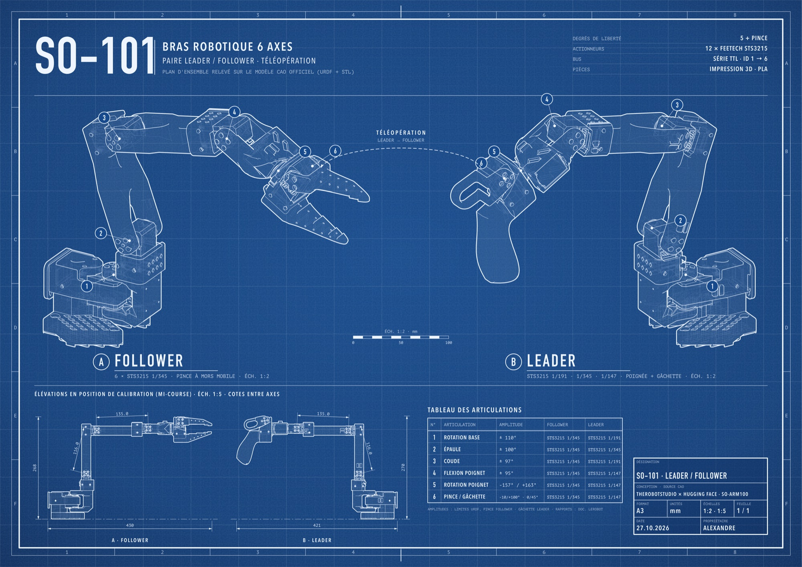

# SO-101 blueprint

Poster A3 façon plan d'ingénieur de la paire de bras SO-101 (leader / follower),
généré à partir du modèle CAO officiel de [SO-ARM100](https://github.com/TheRobotStudio/SO-ARM100)
(URDF + maillages STL).



## Contenu

- `scripts/so101_lines.py` : pose les bras selon l'URDF, extrait les arêtes vives et les
  silhouettes des maillages, teste leur visibilité avec un depth buffer GPU (moderngl) et
  exporte des polylignes 2D en mm.
- `scripts/compose_poster.py` : met en page le poster A3 (SVG en mm) à partir des vues rendues.
- `scripts/preview.py` : aperçu rapide des vues rendues avec matplotlib.
- `scripts/poster_config.json` : poses et directions de vue utilisées pour le poster.
- `poster/` : poster final (SVG, PDF) et aperçu JPEG.

## Installation

```sh
git clone --recurse-submodules git@github.com:alexandreeberhardt/SO-101-blueprint.git
cd SO-101-blueprint
python -m venv .venv
.venv/bin/pip install -r requirements.txt
```

## Génération

```sh
.venv/bin/python scripts/so101_lines.py scripts/poster_config.json poster/views.json
.venv/bin/python scripts/compose_poster.py poster/views.json poster/so101_blueprint_A3.svg
```

Aperçu des vues seules :

```sh
.venv/bin/python scripts/preview.py poster/views.json preview.png
```

Le poster utilise les polices DIN Condensed, Avenir Next Condensed et PT Mono (fournies avec macOS).

## Licence

Les modèles CAO du SO-101 appartiennent à TheRobotStudio et sont distribués sous licence
Apache 2.0 (voir `vendor/SO-ARM100/LICENSE`).
